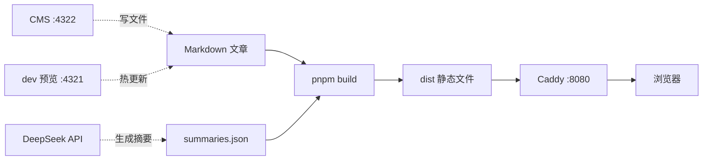

记录这次博客部署方案的调整过程，包括为什么要换、换了什么、以及踩到的坑。

## 一、起点：Docker 四服务方案

最初按一份现成方案部署，用 Compose 编排四个服务：

| 服务 | 作用 | 端口 |
| :--- | :--- | :--- |
| koharu-cms | Web 写作后台 | 4322 |
| koharu-preview | Astro dev 预览 | 4321 |
| koharu-web | Nginx 提供静态站 | 8080 |
| builder | 一次性构建任务 | — |

这套方案本身能跑通，但落地时改了四处才启动起来：

1. 部署包默认路径 `/docker/...`，fnOS 实际是 `/vol1/docker`
2. 文档假设 Lucky 在 bridge 网络，实际是 `host` 网络，无法按容器名反代，改成端口映射
3. `builder` 在 `profiles: ["tools"]` 下，`docker compose run` 必须显式加 `--profile tools`
4. CMS 的 Host 校验只认 localhost，局域网访问 API 全部 403

## 二、意外：容器被批量清理

11-17 晚上 22:25，在 1Panel 里做了一次容器清理操作。docker events 记录：

```text
22:25:04  创建 koharu-cms-modify-backup-150d7cd94c7841dc…
22:28:02  删除 koharu-cms、koharu-preview
22:28:03  删除 1Panel-deepseek-harness
22:28:27  删除 koharu-web
22:28:43  删除镜像 astro-koharu-fnos:local
```

三个容器连同镜像、命名卷一起消失，1Panel 甚至删掉了自己的后台容器。

源码目录还在，但恢复要重建 1.75 GB 镜像（约 15 分钟）再跑一次构建（约 8 分钟）。

## 三、决策：改为主机直装

权衡后放弃 Docker，理由是这台设备上 Docker 的隔离优势没有价值，更新成本却很高：

| 环节 | Docker 方案 | 主机直装 |
| :--- | :--- | :--- |
| 首次环境准备 | 拉镜像 + build 镜像 14m51s | 装 Node + pnpm 约 2 分钟 |
| 版本更新 | 依赖变化要 rebuild 镜像 15 分钟 | `pnpm install` 4m29s |
| 故障面 | builder 版本、Dockerfile 阶段、卷覆盖、容器被误删 | 只有 Node 本身 |
| 常驻开销 | dockerd + 三个容器 | Caddy 13 MB |

## 四、新架构



组件版本：

| 组件 | 版本 | 位置 |
| :--- | :--- | :--- |
| Node | 22.23.5 arm64 | `/opt/node22` |
| pnpm | 10.28.2 | corepack |
| Caddy | 2.11.9 | `/usr/local/bin/caddy` |
| 项目 | astro-koharu v7.7.5 | `/vol1/www/astro-koharu` |

Caddy 由 systemd 服务 `caddy-koharu.service` 守护，已设开机自启。

## 五、五个本地补丁

上游代码有多处假设不适合当前环境，全部做成 `patches/apply.mjs` 里的幂等补丁：

| 补丁 | 文件 | 问题 | 改法 |
| :--- | :--- | :--- | :--- |
| 1 | `cms/server.ts` | Host 只认 localhost，局域网访问 API 403 | 放行 RFC1918 私有网段，公网域名仍拒绝 |
| 2 | `package.json` | `dev` 只监听 `[::1]` | 追加 `--host 0.0.0.0 --port 4321` |
| 3 | `src/scripts/generateSummaries.ts` | API 地址硬编码指向本地 LM Studio | 改读 `SUMMARY_*` 环境变量 |
| 4 | 同上 | 连通性检查不带 Authorization，云端 API 401 被误判为不可用 | 补 `Bearer` 请求头 |
| 5 | `src/pages/post/[...slug].astro` | 摘要面板优先显示手写 description，AI 摘要用不上 | 改为 AI 摘要优先，description 作兜底 |

补丁脚本可重复执行，已存在的会跳过，匹配不上会明确报错。`update.sh` 升级时自动重放。

## 六、接入 AI 摘要

项目自带摘要生成脚本，用的是 OpenAI 兼容接口，改完补丁 3、4 后可接任何服务。

当前接的是 DeepSeek，模型 `deepseek-flash`（`deepseek-chat` 已下线）。

实测数据：

| 项目 | 数值 |
| :--- | :--- |
| 3 篇生成耗时 | 6.0 秒 |
| 单篇 token | 约 3k 输入 + 150 输出 |
| 3 篇成本 | 约 ¥0.02 |
| 全量 38 篇预估 | 约 ¥0.2 |

摘要按「内容 hash + 模型名」缓存，改过的文章重新生成，没动过的走缓存。

需要注意摘要的显示优先级：**写了 `description` 的文章不会显示 AI 摘要**，面板会标注为 `description`；只有不写 description 才会走 AI 摘要（标注 `ai`）。

## 七、性能观察

| 指标 | 数值 |
| :--- | :--- |
| 首次构建（含图片优化） | 7 分 23 秒 |
| 增量构建（图片缓存命中） | 2 分 13 秒（其中图片阶段仅 1 秒） |
| 构建产物 | 307 页 / 1853 文件 / 181 MB |
| pagefind 索引 | 311 页 |
| 首页响应 | 约 25 ms，177–221 KB，gzip 压缩 |
| Caddy 内存 | 13 MB |
| CMS 内存 | 324 MB（仅使用时启动） |
| dev 预览内存 | 约 700 MB（仅使用时启动） |

慢的主要来源是 108 张图片转 avif/webp 多尺寸，以及 pagefind 全文索引。这部分 Hexo 默认不做，所以对比构建速度时要算上功能差异。

## 八、清理动作

- 删除旧 Docker 部署目录 590 MB、本地源码副本 72 MB
- 清理构建缓存 1.754 GB，回收悬空镜像层约 8 GB
- 删除旧后台项目（含明文凭据的部署脚本）
- 磁盘 `/vol1` 从 112 GB 降到 91 GB

## 九、遗留问题

1. 无 `link` 字段的文章，摘要生成脚本用的 key 是相对路径（如 `note/shoka-features`），页面查找用的是另一套 slug 规则，两者是否始终一致尚未逐一验证。
2. `pnpm koharu generate summaries` 是交互式 TUI，脚本化调用必须绕过 CLI 直调 `tsx src/scripts/generateSummaries.ts`。
3. 部分 Markdown 扩展（如脚注）渲染不完全，会退化为普通文本，不影响构建。
4. 设备温度在 CPU 68°C、DDR 69°C 附近，风扇策略由 fnOS 管理，暂未干预。

## 十、小结

主机直装的核心收益不是"更快"，而是**故障面变小**：从「Docker daemon + 镜像层 + Compose 编排 + 容器被误删」简化到「Node 进程 + 一个静态服务器」。代价是宿主多了一个 Node 运行时，通过独立目录 `/opt/node22` 隔离，不碰系统包管理器。
