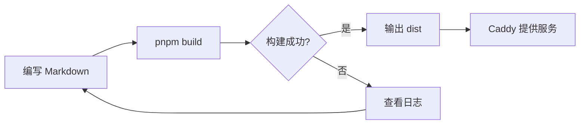
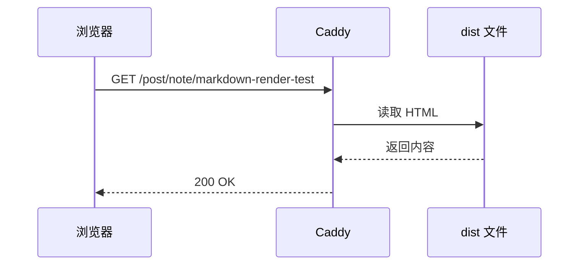
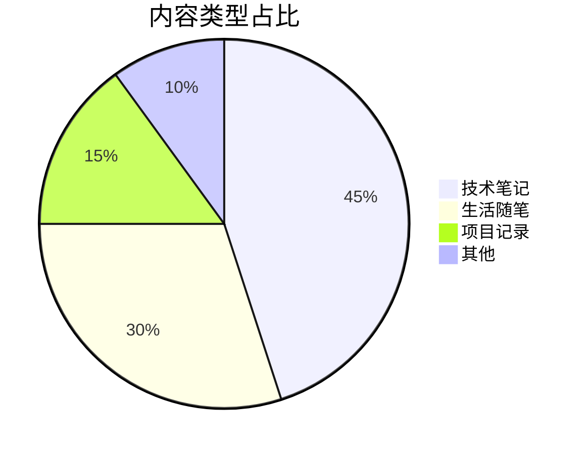

本文用于验证 astro-koharu 在当前部署环境下的 Markdown 渲染是否完整。每个小节对应一个能力项，可直接对照页面显示效果。

## 一、测试清单

| 序号 | 能力项 | 语法来源 | 预期结果 |
| :--- | :--- | :--- | ---: |
| 1 | 标题层级 | 标准 MD | h2–h6 正常 + 锚点 |
| 2 | 文本样式 | 标准 + Shoka | 样式生效不串行 |
| 3 | 列表嵌套 | 标准 MD | 缩进层级正确 |
| 4 | 任务列表 | GFM | 复选框可显示 |
| 5 | 表格对齐 | GFM | 左/中/右对齐 |
| 6 | 代码高亮 | Shiki | 多语言着色 |
| 7 | 数学公式 | KaTeX | 行内与块级渲染 |
| 8 | 图表 | Mermaid | SVG 绘制成功 |
| 9 | 图片 | Astro Image | LQIP 占位 |
| 10 | 容器块 | directive | 样式区块 |
| 11 | 内联 HTML | rehype-raw | 原样输出 |
| 12 | 加密内容 | 自定义插件 | 需密码解锁 |

## 二、标题层级

下面是三到六级标题，均会自动生成锚点，可点击标题右侧链接直达。

### 三级标题

#### 四级标题

##### 五级标题

###### 六级标题

## 三、文本样式

基础样式：**粗体**、_斜体_、~~删除线~~、`行内代码`、[外部链接](https://astro.build)、**粗体里嵌 _斜体_ 再嵌 `代码`**。

Shoka 扩展样式：

- 高亮：==这段文字应该带高亮背景==
- 下划线：++这段文字应该带下划线++
- 上标与下标：水的化学式 H~2~O，质能方程 E=mc^2
- 注音：{漢字^かんじ} 应显示上方假名
- 隐藏文字：!!鼠标悬停才显示!! 以及 !!模糊效果!!{.blur}

## 四、列表

### 无序列表（三层嵌套）

- 第一层 A
  - 第二层 A-1
    - 第三层 A-1-a
    - 第三层 A-1-b
  - 第二层 A-2
- 第一层 B

### 有序列表（含混合嵌套）

1. 准备环境
2. 安装依赖
   1. 安装 Node 22
   2. 安装 pnpm
3. 构建站点
4. 启动服务

### 任务列表

- [x] 部署 Node 运行时
- [x] 安装项目依赖
- [x] 首次构建通过
- [ ] 完成渲染验证
- [ ] 撰写正式内容

## 五、表格

| 左对齐 | 居中 | 右对齐 |
| :----- | :--: | -----: |
| a | b | 1 |
| 较长的一列内容 | 中 | 22 |
| x | y | 333 |

## 六、引用

> 一级引用：静态站点在构建期把 Markdown 编译为 HTML。
>
> > 二级引用：因此内容更新需要重新构建，而不是刷新页面。
>
> 回到一级引用。

## 七、代码块

### 带标题与高亮行

```javascript title="greet.js" {3-5}
function greet(name) {
  // 下面三行应高亮
  const time = new Date().toISOString();
  const msg = `Hello, ${name}`;
  return { msg, time };
}
```

### 命令行提示符

```bash command
pnpm install --frozen-lockfile
pnpm build
```

### JSON

```json
{
  "site": "astro-koharu",
  "renderer": "Astro 7",
  "features": ["gfm", "katex", "mermaid", "shiki"]
}
```

### Python

```python
def fib(n: int) -> list[int]:
    seq = [0, 1]
    while len(seq) < n:
        seq.append(seq[-1] + seq[-2])
    return seq[:n]

print(fib(10))
```

## 八、数学公式

行内公式：质能等价 $E = mc^2$，欧拉恒等式 $e^{i\pi} + 1 = 0$。

块级公式：

$$
\int_{-\infty}^{\infty} e^{-x^2}\,dx = \sqrt{\pi}
$$

矩阵：

$$
\begin{pmatrix}
a & b \\
c & d
\end{pmatrix}
\begin{pmatrix}
x \\
y
\end{pmatrix}
=
\begin{pmatrix}
ax + by \\
cx + dy
\end{pmatrix}
$$

## 九、Mermaid 图表

### 流程图



### 时序图



### 饼图



## 十、图片

图片应带有 LQIP 占位，加载完成后淡入：


## 十一、容器块

:::info
信息块：这是 `:::info` 容器的渲染效果。
:::

:::tip
提示块：如果该容器未生效，会退化为普通段落文本，不影响构建。
:::

:::warning
警告块：用于强调需要注意的内容。
:::

## 十二、内联 HTML

键盘按键：<kbd>Ctrl</kbd> + <kbd>C</kbd> 可中断前台进程。

内联高亮标签：<mark>这段由 mark 标签标记</mark>。

<details>
<summary>点击展开（details 折叠）</summary>

折叠内部的内容，验证原生 HTML 是否被保留。

</details>

## 十三、加密内容

下面这段使用 AES-256-GCM 在构建期加密，密码为 `demo`：

:::encrypted{password="demo"}
这段内容已加密，输入密码即可查看。

支持完整 Markdown，包括公式 $a^2 + b^2 = c^2$ 与代码：

```python
print("Hello from encrypted block")
```

:::

## 十四、脚注

静态站点在构建期完成渲染[^build]，因此页面打开速度与数据库无关[^static]。

[^build]: 构建由 `astro build` 执行，产物为纯 HTML。
[^static]: 没有运行时查询，所以首屏不依赖后端。

---

## 结论

以上各节若均按预期显示，说明渲染管线（Markdown → remark/rehype → Astro → HTML）完整可用。

如果某一项显示为原始文本（例如 `:::info` 原样出现），说明该容器语法在当前版本未启用，但不影响其他内容构建。
